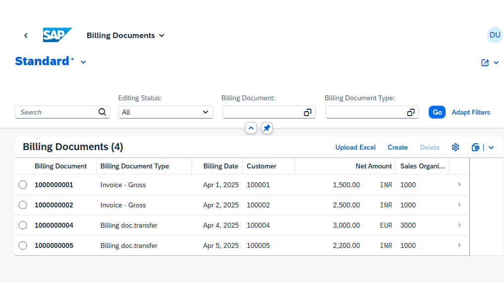

# RAP Excel Upload: Billing Documents

A RAP practice app for billing documents (header and items) with an **Upload Excel** button in a Fiori elements List Report. The uploaded documents are created as **drafts**, so users can review them before activating.



## Features

- Managed RAP business object with draft and late numbering
- Static action `uploadExcel` that reads `.xlsx` files with the XCO library
- Rows are grouped into documents by `DocRef`, one header with several items each
- Custom **Upload Excel** button and controller extension in a Fiori elements V2 List Report
- Error messages for empty or unreadable files

## Tested on

- SAP S/4HANA 2023 FPS00, on-premise (SAP_BASIS 758, S4CORE 108)
- Fiori elements V2 List Report, SAPUI5 1.114+
- Uploads of 1,000 rows (200 documents)

## Repository structure

```
.abapgit.xml   abapGit metadata
src/           ABAP objects (tables, CDS views, behavior, service)
app/           Fiori elements app (List Report)
```

Main ABAP objects:

| Object | Type |
|---|---|
| `ZBILL_HEADER`, `ZBILL_ITEM` | Database tables |
| `ZDBILL_HEAD`, `ZDBILL_ITEM` | Draft tables |
| `ZI_BILL_HEADER`, `ZI_BILL_ITEM` | Interface CDS views and behavior definition |
| `ZC_BILL_HEADER`, `ZC_BILL_ITEM` | Projection views and behavior definition |
| `ZBP_I_BILL_HEADER` | Behavior implementation, including `uploadExcel` |
| `ZA_BILL_UPLOAD` | Abstract entity for the file parameter |
| `ZC_UI_BILL_HEADER` | Service definition |
| `ZC_UI_BILLHEADER_V2` | Service binding (OData V2 UI) |

## Setup

### 1. Backend

1. Install [abapGit](https://docs.abapgit.org) in your system.
2. Create a package, for example `$ZBILLING_APPS`.
3. Import the repository into the package with **New Online** and the repository URL. For an offline import, unzip the ZIP downloaded from GitHub and zip its contents again, so that `.abapgit.xml` is at the root of the ZIP.
4. Activate all objects.
5. Open the service binding `ZC_UI_BILLHEADER_V2` in ADT and publish it.

### 2. Frontend

You can run the app in SAP Business Application Studio, or locally in VS Code with SAP Fiori tools.

**BAS with an on-premise system:** the system must be reachable from BTP. Connect it with SAP Cloud Connector and create a destination in the BTP cockpit.

1. Open the `app` folder and run `npm install`.
2. In `ui5.yaml`, `ui5-local.yaml`, `ui5-mock.yaml` and `ui5-deploy.yaml`, replace the destination `SANDBOX` and the URL `http://sandbox:443` with your own values.
3. Run `npm start`.

## Excel format

The first row is a header row and is skipped. Columns are read **by position**, so keep this order:

| DocRef | BillType | BillDate | CustomerId | SalesOrg | Currency | MaterialId | Description | Quantity | Uom | ItemAmount |
|---|---|---|---|---|---|---|---|---|---|---|
| 1 | Y1 | 20260930 | 100001 | 1000 | EUR | MAT01 | sample item desc 1 | 5 | PC | 100 |
| 1 | Y1 | 20260930 | 100001 | 1000 | EUR | MAT02 | sample item desc 2 | 2 | PC | 40 |
| 2 | Y1 | 20260930 | 100002 | 1000 | EUR | MAT01 | sample item desc 3 | 1 | PC | 20 |

Rows with the same `DocRef` become one billing document. The example above creates two documents.

## How it works

1. The **Upload Excel** button is defined in `manifest.json` as a controller extension action.
2. `ListReportExt.controller.js` opens a dialog with a `FileUploader`, reads the file in the browser and calls the static action `uploadExcel`.
3. `uploadExcel` reads the first worksheet with `XCO_CP_XLSX`, groups the rows by `DocRef` and creates the headers and items as drafts with `MODIFY ENTITIES`.
4. Users review the drafts in the List Report and activate them.

## Known limitations

- The XCO library may fail on `.xlsx` files that were not created by Excel (for example, files generated by other tools that use inline strings). Opening and saving the file in Excel fixes this.
- The file is passed as a hex-encoded action parameter. This works through `$batch`, but very large files may hit request size limits.
